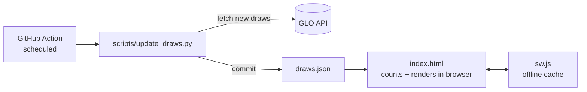

# thai-lottery-2digit-stats

Frequency stats for the last two digits of the Thai Government Lottery, as an installable offline-capable PWA.

## Features

- 10×10 heatmap of 00–99, or sortable frequency / number lists
- 5 / 10 / 20-year range
- Quick search and per-number draw dates
- Hottest and never-drawn number summaries
- Works offline (PWA)

## How it works

## Data credits

- Draws 2006–2024: [heart/Data-Set-Thai-Lotto](https://github.com/heart/Data-Set-Thai-Lotto) (sourced from sanook.com)
- Draws 2025–2026: [myhora.com](https://www.myhora.com/)
- New draws: [Government Lottery Office (GLO)](https://www.glo.or.th/) API

Counts were cross-checked against myhora.com's published statistics.

Visitor counts via [GoatCounter](https://www.goatcounter.com/) (anonymous, no cookies).
